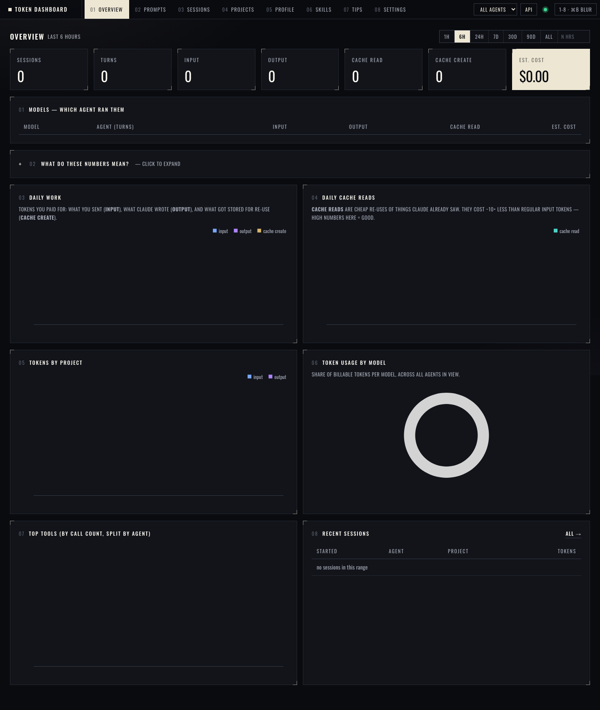

# TOKEN DASHBOARD

**See where your AI-coding tokens went.** A local-first dashboard for Claude Code, Codex, Hermes and any other harness you use. One small file, nothing to install, nothing leaves your machine.

## Download (free beta)

Get the file for your system from the [latest release](../../releases/latest), unzip it and run it.

| System | File |
|---|---|
| macOS (Apple Silicon) | `token-dashboard_*_darwin_arm64.tar.gz` |
| macOS (Intel) | `token-dashboard_*_darwin_amd64.tar.gz` |
| Windows | `token-dashboard_*_windows_amd64.zip` |
| Linux (x86-64 / ARM64) | `token-dashboard_*_linux_amd64.tar.gz` / `_linux_arm64.tar.gz` |

No Python, Node or Docker needed. Check the download against `SHA256SUMS.txt` if you like.

## First run

1. Run `token-dashboard`. The dashboard opens in its own window.
2. Pick the harnesses to track. Claude Code, Codex and Hermes are listed by default and you can edit, remove or add your own (any tool that writes the simple `generic` log format).
3. It scans your history and shows your usage. Change the sources any time in **Settings → Sources**.

**Unsigned beta:** macOS shows "unidentified developer" the first time (right-click the app → Open, or `xattr -d com.apple.quarantine token-dashboard`). Windows SmartScreen shows "More info → Run anyway". Signed builds will come later.

## What you get

Cost and token breakdowns by agent, model, project and day · session drill-downs · skill usage · a rule-based tips engine that spots repeat reads, oversized models for small turns and cache misses · local "builder profile".

## Privacy

Everything is read from files on your machine and stored in a local SQLite file. No account, no telemetry, no network calls.

## Docs

Full docs: see [`docs/`](docs/index.md) (also published on Read the Docs).

## Licence and credits

Free to use during the beta. Source is not published. Built on the MIT-licensed [nateherkai/token-dashboard](https://github.com/nateherkai/token-dashboard); upstream notices are in [`NOTICE`](NOTICE).
