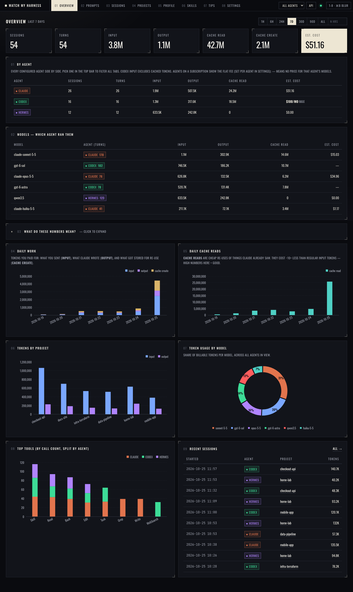
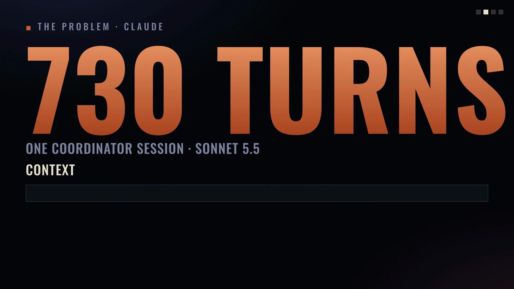

# WATCH MY HARNESS

**Token Dashboard: see where your AI-coding tokens went.** A local-first dashboard for Claude Code, Codex, Hermes and any other harness you use. Open source (MIT). Pick the Go build (one small file) or the Python edition (clone and run). Nothing leaves your machine.



## Watch the 70-second demo

[](media/watch-my-harness-demo.mp4)

What it is and why it exists, in 70 seconds (click to play).

## Download (beta)

Get the file for your system from the [latest release](../../releases/latest), unzip it and run it.

| System | File |
|---|---|
| macOS (Apple Silicon) | `watch-my-harness_*_darwin_arm64.tar.gz` |
| macOS (Intel) | `watch-my-harness_*_darwin_amd64.tar.gz` |
| Windows | `watch-my-harness_*_windows_amd64.zip` |
| Linux (x86-64 / ARM64) | `watch-my-harness_*_linux_amd64.tar.gz` / `_linux_arm64.tar.gz` |

No Python, Node or Docker needed. Check the download against `SHA256SUMS.txt` if you like.

## Or build it yourself

You need [Go](https://go.dev/dl/) (version in `go.mod`). Nothing else: no CGO, no Node.

```sh
go install github.com/KVSDURGASURESH/watch-my-harness/go/cmd/watch-my-harness@latest
watch-my-harness
```

Or from a checkout: `go build -o watch-my-harness ./go/cmd/watch-my-harness`. Run the tests with `go test ./...`.

## Or run the Python edition

Prefer readable source over a download, or no Go installed? The Python edition is the same dashboard in standard-library Python
(3.9+, no pip, no build). Same screens, same data, same snapshots.

```sh
git clone https://github.com/KVSDURGASURESH/watch-my-harness
cd watch-my-harness && ./python/run.sh        # Windows: py python\cli.py dashboard
```

Details and a comparison: [Python edition](docs/python.md).

## First run

1. Run `watch-my-harness`. The dashboard opens in its own window.
2. Pick the harnesses to track. Claude Code, Codex and Hermes are listed by default and you can edit, remove or add your own (any tool that writes the simple `generic` log format).
3. It scans your history and shows your usage. Change the sources any time in **Settings → Sources**.

**Unsigned beta (the Go downloads):** macOS shows "unidentified developer" the first time (right-click the app → Open, or `xattr -d com.apple.quarantine watch-my-harness`). Windows SmartScreen shows "More info → Run anyway". Signed builds will come later.

## What you get

Cost and token breakdowns by agent, model, project and day · session drill-downs · skill usage · a rule-based tips engine that spots repeat reads, oversized models for small turns and cache misses · local "builder profile" · an archive that keeps your history after Claude Code deletes its own session files.

## Privacy

Everything is read from files on your machine and stored in a local SQLite file. No account, no telemetry, no network calls.

## Docs

Full docs: see [`docs/`](docs/index.md) (also published on Read the Docs).

## Licence and credits

MIT. See [`LICENSE`](LICENSE). Built on the MIT-licensed [nateherkai/token-dashboard](https://github.com/nateherkai/token-dashboard); upstream and third-party notices are in [`NOTICE`](NOTICE). Issues and pull requests are welcome; see [`CONTRIBUTING.md`](CONTRIBUTING.md).
